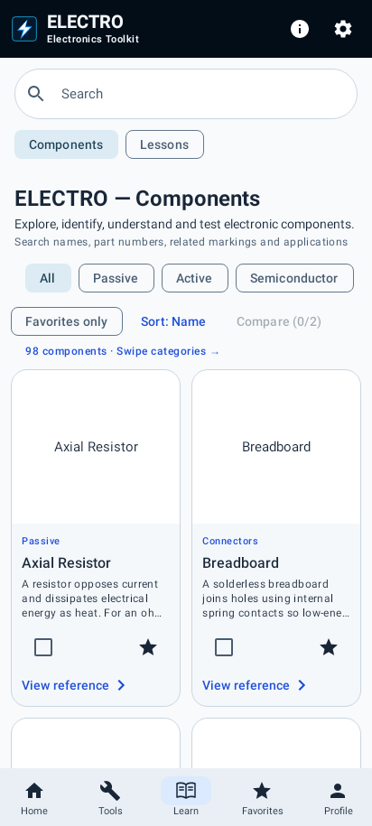
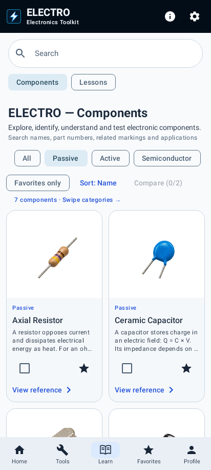
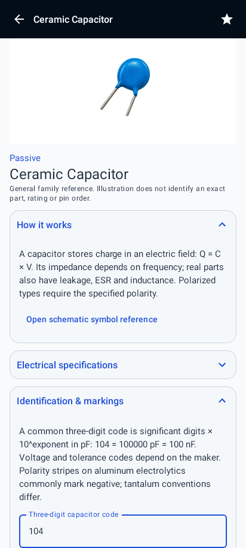
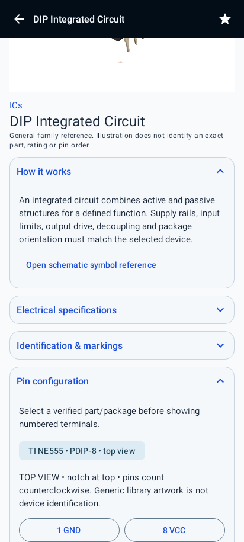

# ELECTRO Components review

Actual Compose screens rendered by Robolectric simulated Android (412 dp wide). These are not photographs from a physical phone and do not establish Play Protect approval.

## Dark library

## Light library

## Capacitor identification

## Selected-package pinout

The selected TI NE555 PDIP-8 top view is the only numbered component pinout added in this review. All 98 original records/images are retained. Additional requested component types, new imagery, camera recognition and the full illustration set remain unfinished.
